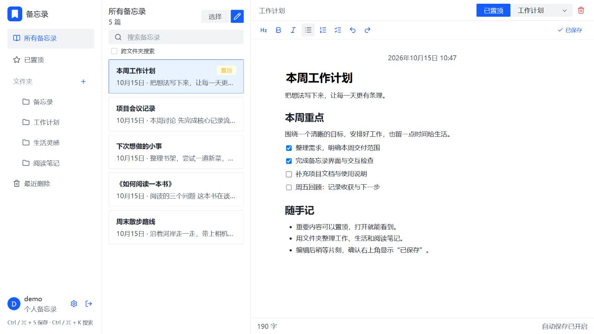
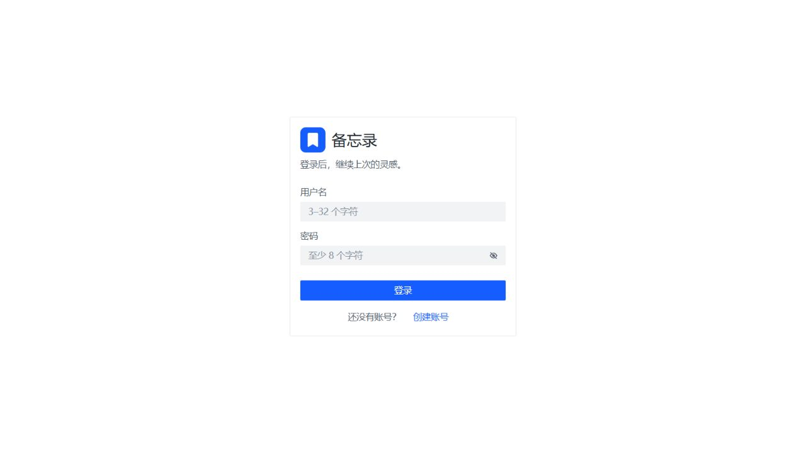
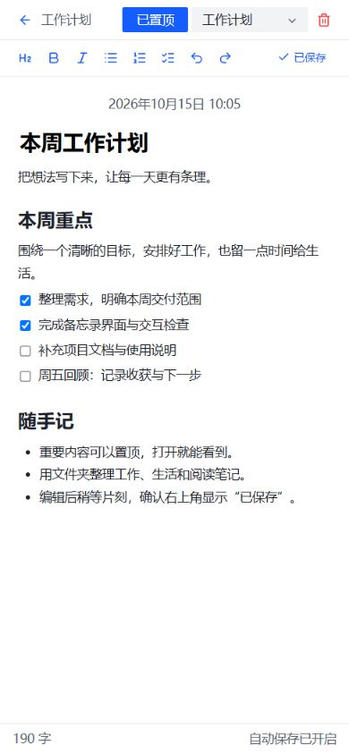
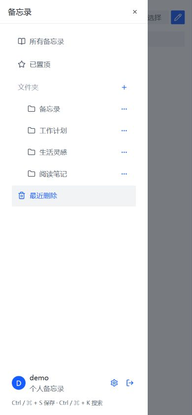
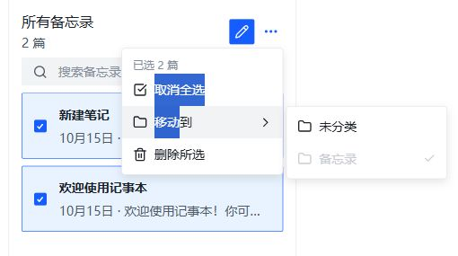
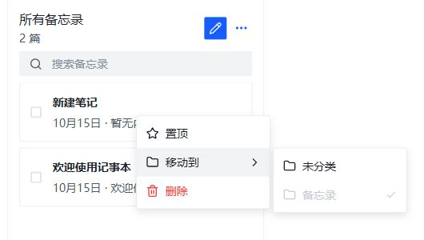
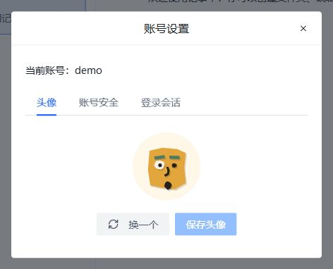
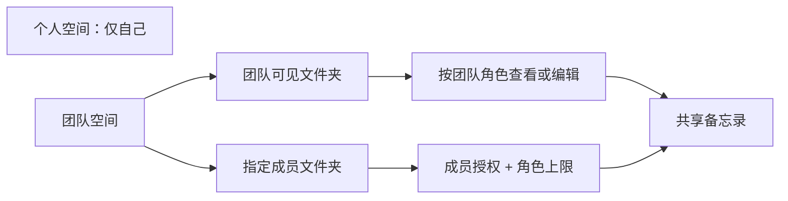

# 备忘录

轻量、可自托管的备忘录 Web 应用。用文件夹整理日常记录，用富文本和待办清单梳理想法，登录同一账号即可在不同设备访问，也可创建团队，与成员共享和协作编辑备忘录。

界面参考 macOS 备忘录，基于 Arco Design 原生组件；React + TypeScript 构建前端，Hono + SQLite 提供后端，一个服务即可同时提供页面与 API。

[界面预览](#界面预览) · [功能](#功能) · [快速开始](#快速开始) · [Docker 部署](#docker-部署) · [数据与备份](#数据与备份) · [常见问题](#常见问题)

## 界面预览

以下截图来自本地运行的应用，使用独立演示账号与示例笔记，不包含真实用户数据。图片随仓库保存在 [`docs/images/`](docs/images/)。

### 桌面：文件夹、笔记列表与编辑区



桌面端采用三栏布局，置顶记录优先展示；编辑区提供格式工具、文件夹切换与保存状态。

### 登录与账号



注册后即可开始使用，每个账号拥有独立的文件夹与笔记。

### 手机：专注编辑



窄屏下列表与编辑区分别显示，点击左上角箭头返回列表。列表顶部的菜单按钮可打开文件夹抽屉，管理文件夹、进入账号管理或退出登录；长标题与摘要会截断显示，避免页面横向溢出。



## 功能

| 功能 | 说明 |
| --- | --- |
| 账号与隔离 | 注册、登录、退出、修改密码、退出其他设备；接口按当前登录用户隔离数据 |
| 个性头像 | DiceBear 本地生成，统一 Cutouts 剪纸风格；支持换一个并保存到账号 |
| 文件夹 | 个人文件夹删除后笔记移至未分类；团队文件夹支持成员权限、删除及恢复 |
| 通知中心 | 个人操作与团队事件、简洁消息列表、自动已读与分页 |
| 团队协作 | 多空间、四种角色、用户名邀请、多人邀请链接、成员管理、团队解散与恢复 |
| 活动记录 | 团队事件按时间倒序、每页 20 条；成员角色变更显示昵称、用户名与中文角色 |
| 实时编辑 | 团队标题与正文实时合并；在线成员头像、彩色光标、用户名和选区；断线重连后合并修改 |
| 笔记管理 | 新建、编辑、置顶、移动文件夹、移到最近删除、恢复及永久删除；支持批量移动、软删除与恢复 |
| 富文本 | 标题、粗体、斜体、有序／无序列表、待办清单、撤销与重做；正文右键菜单支持剪贴板、格式与插入操作 |
| 正文图片 | 选择、粘贴截图、拖入图片；上传进度、失败重试与放大预览，沿用文档权限和历史恢复 |
| 搜索 | 匹配当前分类中的标题与正文；置顶优先，其余按修改时间倒序 |
| 自动保存 | 个人备忘录停止输入约 700 毫秒后保存；团队实时同步，服务器落盘确认后显示已保存 |
| 多设备编辑 | 登录同一账号访问；版本冲突时可采用服务器版本或将本地编辑另存为副本 |
| 昵称 | 注册时选填，账号设置中修改；在线头像、光标、评论、成员列表优先显示昵称，登录与邀请仍使用用户名 |
| 历史版本 | 预览并恢复旧标题和富文本；连续编辑按分钟保留快照，恢复前保存当前版本，最多 100 个 |
| 草稿恢复 | 未同步编辑保存在当前浏览器；个人草稿支持恢复或另存副本，团队草稿重连后合并 |
| 评论与提及 | 团队备忘录支持整篇评论、评论回复、@成员标签和通知提醒，正文右键可打开评论区 |
| 直接链接 | 复制备忘录链接，登录后直接定位到个人或团队备忘录；始终校验原有访问权限 |
| 导入导出 | 导入 MD／纯文本，单篇下载导出；不保存上传文件或附件 |
| 自托管 | 本地 Node.js 或 Docker 部署；SQLite 数据保存在持久化目录 |

### 基本操作

1. 点击「创建账号」注册：用户名 3–32 位，以英文字母开头，仅支持英文字母、数字和下划线，如 `notes_2026`；密码 8–128 个字符。新账号会获得默认文件夹和欢迎笔记。
2. 点击列表右上角的铅笔按钮新建备忘录，填写标题与正文；离开页面前确认状态为「已保存」。
3. 点击侧栏「文件夹」右侧的加号创建文件夹，悬停文件夹后打开三点菜单管理；编辑区顶部的下拉框可移动当前笔记。
4. 点击「置顶」保留重要记录；搜索框只筛选当前分类中的内容。
5. 删除笔记后可到「最近删除」恢复；永久删除无法通过应用恢复。

### 手机导航、批量操作与快捷键

- 手机／平板宽度不超过 900 像素时使用抽屉导航；点击列表左上角菜单打开文件夹和账号入口。
- 移动布局及触摸设备不显示 tooltip，包括按钮、协作头像与文字提示；桌面保留提示。
- 卡片默认显示勾选框，点击卡片内容打开编辑器，勾选框用于批量选择。新建按钮右侧的「更多」菜单提供全选、移动到与删除所选；悬浮「移动到」展开文件夹列表，个人空间点击目标立即批量移动；团队空间先确认目标权限变化。全部所选笔记位于同一文件夹时标记并禁用该目标；最近删除中提供恢复所选。每次最多操作 100 篇。
- 右键点击卡片，或在手机端点击卡片右侧更多按钮，可置顶／取消置顶、移动或删除该篇笔记。悬浮「移动到」展开文件夹列表，个人空间点击目标立即移动，团队空间先确认权限变化；当前文件夹会标记并禁用。删除会移入最近删除，可通过右键菜单恢复。右键操作只影响该卡片，与批量勾选独立。
- 在编辑器正文内右键可撤销、重做、剪切、复制、粘贴和全选，并通过子菜单设置文字格式、列表、待办、引用、代码块及分割线。选中文字后右键会保留选区，只读时禁用修改操作；浏览器限制剪贴板访问时，可按菜单提示使用系统快捷键。
- 正文中的链接需按住 `Alt`（Mac 为 `Option`）再单击才在新标签打开；仅按住该键时显示手型，普通点击用于编辑和选择文字。个人、团队备忘录及历史预览采用相同规则。
- 批量操作会校验全部笔记的归属与版本；任何一篇版本冲突时整批不执行，刷新结果后重新选择。
- 搜索框只检索当前分类；切换分类或修改搜索关键词后清空勾选。





| 快捷键 | 操作 |
| --- | --- |
| `Ctrl+S` / `⌘S` | 立即保存当前编辑，阻止浏览器弹出另存网页；网络错误或版本冲突仍会提示 |
| `Ctrl+K` / `⌘K` | 聚焦搜索框；手机编辑页会先保存并返回列表 |
| `Esc` | 关闭更多菜单或清空勾选；手机编辑页返回列表（有弹窗时优先由弹窗处理） |

### 账号管理

注册时可以选填昵称，留空则默认使用用户名；已有账号升级后也使用用户名作为默认昵称。在「账号设置 → 个人资料」中可修改 1–32 字符的昵称，在线协作中的头像提示和光标名称会即时更新，昵称允许重复。用户名保持唯一，用于登录、邀请和区分同名成员。

新用户名采用白名单校验：3–32 位、英文字母开头，后续仅限英文字母、数字和下划线，唯一性与登录均不区分大小写。空格（含首尾空格）、中文、表情、全角字符及其他标点均不能用于注册；注册页与服务端共享同一规则，直接调用接口也无法绕过。该规则采用 [OWASP 建议的白名单与服务端校验原则](https://cheatsheetseries.owasp.org/cheatsheets/Input_Validation_Cheat_Sheet.html)，具体字符范围为本项目的账号策略。历史账号保留原登录方式及邀请识别，不会自动改名或失效；昵称仍支持中文和表情。

侧栏底部仅显示头像、昵称和右箭头。鼠标悬浮时在右侧弹出账号菜单；手机抽屉中点击展开。选择「账号设置」进入独立页面，提供「个人资料」「头像」「账号安全」「登录会话」四个页签；内容宽度与团队设置、通知中心保持一致，页签栏支持吸顶。

「头像」统一使用 Cutouts 剪纸风格；可点「换一个」预览，点击「保存头像」后才生效。离开设置页面会丢弃未保存的头像预览。头像配置保存在当前账号中，刷新、重新登录或其他设备刷新后保持一致；旧账号自动获得基于用户 ID 的稳定默认头像，原笔记及会话保留。修改头像不会重新加载笔记列表。



在「账号安全」中修改密码须输入当前密码及两次新密码，新密码为 8–128 个字符，不能与旧密码相同。成功后服务端轮换当前会话令牌，退出其他设备，本设备保持登录。

在独立的「登录会话」页签中，「退出其他设备」需要验证当前密码，只撤销同一账号的其他登录会话；显示的是会话数量，同一设备多次登录也可能产生多个会话。

头像由打包在应用内的 DiceBear JavaScript 库生成 SVG，以 data URI 显示，不请求第三方头像 API。仅保存风格和随机标识，不接受上传 SVG 或外部图片地址。核心库采用 MIT 许可；本项目仅选用的 [Cutouts](https://www.dicebear.com/styles/cutouts/) 风格由 DiceBear 创作，采用 CC0 1.0 许可，作者及来源见依赖中的样式元数据。依赖版本锁定，升级 DiceBear 时需检查既有 seed 的头像外观是否变化。

### 通知中心

点击左下角头像上方的「通知中心」进入独立页面；手机端从导航抽屉进入。通知按账号保存，按时间倒序展示；进入页面自动将已有通知标为已读，可继续加载历史消息。消息仅展示标题、内容、来源和时间，以上下边框分隔；点击「查看备忘录」打开当前有权访问的内容，点击「查看邀请」进入团队邀请页面。

- 备忘录事件：个人与团队备忘录的移动、删除、恢复及永久删除；批量操作按篇记录。日常自动保存和重复提交不会产生通知。
- 团队事件：站内邀请、重新邀请、接受／拒绝／撤销、本人角色变化、离开或被移出团队，以及团队解散／恢复。邀请链接不向未知账号广播，令牌不进入通知。
- 团队备忘录事件只送达操作后可见该备忘录的成员；读取通知和未读计数时再次校验当前权限。被移除、撤权或团队解散后，对应备忘录通知暂不展示；解散及本人成员关系等通知仍保留。
- 新功能启用后开始记录事件，已有待处理的站内邀请会补入通知中心。页面每 30 秒或回到窗口时检查未读数量；进入通知中心前会先保存当前编辑。

### 团队与共享

在侧栏品牌下方切换「个人空间／团队空间」。切换前会保存当前编辑；保存失败或仍有冲突时停留在原空间。

1. 打开空间选择器，点击下拉菜单最后一项「创建团队」，填写名称、简介和图标。创建者成为所有者。
2. 从左下角进入「团队设置」独立页面，在「邀请」页签输入对方完整用户名，或生成 7 天有效、可供多人使用的邀请链接。默认角色为查看者，也可选择编辑者。每位有邀请权限的成员在每个团队只有一项链接设置，可再次复制、关闭或重新生成；关闭立即停止加入，重新生成使旧链接立即失效，已加入成员不受影响。页面仅列出站内邀请，不累计链接生成记录。接收者登录后在「团队邀请」页面明确接受才加入。

邀请链接校验使用令牌哈希；为支持再次复制，原令牌通过 AES-GCM 加密保存，密钥位于数据目录中的 `invitation-link.key`，仅链接创建者在保有邀请权限时可读取自己的链接。升级旧版时，每人每团队保留最新的一项链接记录；旧版链接需重新生成后才能在设置页复制。
3. 「成员」页可搜索成员、调整角色和移除。所有者可管理管理员，管理员仅能管理编辑者和查看者。退出或被移除后，其创建的团队资料仍保留。
4. 「文件夹权限」可设为团队可见，或给指定成员授予查看／编辑。角色是上限；所有者和管理员始终拥有全部团队资料权限。
5. 团队空间沿用个人空间的备忘录列表与富文本编辑器，支持新建、编辑、搜索、置顶、移动、批量操作和最近删除；按成员及文件夹权限开放操作。
6. 切换到团队空间后直接新建团队备忘录；团队内移动会提示继承目标文件夹权限。

| 角色 | 备忘录权限 | 管理能力 |
| --- | --- | --- |
| 所有者 | 全部查看与编辑 | 全部管理、解散／恢复团队 |
| 管理员 | 全部查看与编辑 | 团队信息、文件夹权限、邀请、编辑者／查看者管理、活动、永久删除 |
| 编辑者 | 获授权范围内新建、编辑、置顶、移动、删除与恢复 | 不能管理文件夹、成员或永久删除 |
| 查看者 | 获授权范围内阅读与搜索 | 无写权限 |



团队备忘录的标题和正文通过 Yjs + Hocuspocus 实时合并，编辑器顶部显示在线成员的 Cutouts 头像；悬浮、聚焦或点击头像查看用户名及编辑／查看状态。正文中的远端光标带用户名，选区使用同色半透明背景；同一成员多个窗口的头像合并显示，最多展示 4 个头像，其余以 `+N` 展示。撤销仅针对自己的正文操作。

团队编辑以服务器落盘回执作为「已保存」依据，`Ctrl/Cmd+S` 立即发送待同步修改并等待确认。已经打开的页面在短暂断线期间可以继续输入，重连后自动合并；有未保存修改时切换页面会等待保存，关闭页面会提示。未同步内容同时保存为当前浏览器的恢复草稿，刷新或重新打开并恢复连接后会合并；权限被收回时停止协作，有未保存草稿则提供复制机会。个人空间仍沿用版本冲突保护。

### 历史、草稿、评论与链接

- 编辑区顶部「更多 → 历史版本」打开侧栏，按时间查看修改人及旧内容，富文本预览只读；有编辑权限的成员可以恢复。恢复作为一次新的修改同步给在线成员，恢复前的当前内容也会保留。新功能启用后开始记录，连续编辑按分钟合并，每篇最多保留 100 个快照；移动、置顶和光标变化不单独创建快照。
- 个人备忘录重新打开时发现草稿，会显示「恢复编辑」「另存副本」「丢弃草稿」。如果服务器版本已有变化，恢复编辑后仍需处理冲突，不会直接覆盖。团队草稿保留 CRDT 状态，在重连后合并其他成员的修改；服务器确认保存后才清除相应草稿。
- 草稿按账号、空间、备忘录与编辑实例隔离，仅存在本设备的浏览器存储中；清理网站数据会丢失本地草稿，尚未支持完全离线启动。浏览器存储不可用或容量不足时会明确提示，服务器已保存的数据不受影响。
- 团队编辑区「更多 → 评论」或正文右键「评论」打开评论侧栏，点击外部关闭。输入 `@` 选择当前有权访问备忘录的成员，昵称作为整体标签显示和删除；可用方向键与回车选择成员，`Enter` 发送评论、`Shift+Enter` 换行，中文输入法确认文字时不会误发送。点击评论下的「回复」指定回复对象，也可回复讨论串中的任意回复；回复收在原评论下，可展开或收起，发送失败保留草稿和回复对象。被回复或提及的人会收到通知，同一人不重复提醒。评论以头像、昵称、正文和时间排列，评论作者或管理员可删除；删除原评论会一并删除该讨论串，删除单条回复会保留其他人的后续回复。查看者可阅读。侧栏打开期间定期同步新评论。撤回文件夹权限后，历史评论及相关提及通知也不可读取。
- 卡片右键菜单或编辑区「更多 → 复制链接」生成当前备忘录的直接链接。登录后自动定位到对应空间；链接不授予额外权限，不支持匿名公开阅读。个人备忘录链接仅本人可打开。

### 搜索与文字导入导出

- 搜索仍限定当前分类，匹配标题与正文；结果高亮关键词，摘要定位到正文匹配处。输入关键词后可筛选今天、近 7 天、近 30 天修改的备忘录，`↑`／`↓` 选择结果，`Enter` 打开。
- 列表「更多 → 导入 MD / 文本」将文件转换为当前文件夹中的新备忘录。支持 `.md`、`.markdown`、`.txt`，每批最多 20 个、请求总计不超过 1 MB，单篇正文不超过 20 万字。首个一级 Markdown 标题可作为标题；支持标题、粗体、斜体、链接、列表、待办、引用与代码块。HTML 和不支持的结构作为文字保留；同一空间内有权读取的本站图片引用可保留，外部图片仅保留描述，不自动下载。
- 卡片右键可导出单篇 MD，编辑区「更多」可导出单篇 MD 或纯文本。团队查看者可导出自己有权访问的备忘录，导入需要目标位置的编辑权限；每批导入原子执行，任一内容无效时整批不创建。

### 插入图片与自动清理

个人和团队编辑器支持工具栏「插入图片」、正文右键「插入 → 图片」、粘贴截图和拖入图片。支持 JPG、PNG、静态 WebP，单张最多 10 MB、4000 万像素，一次最多 10 张；最多同时上传两张。上传占位显示进度，失败可重试或取消；保存及切换备忘录会等待上传完成。点击正文或历史预览中的图片可放大，手机上图片自动适应编辑区宽度。

拖动图片右下角的手柄可等比例缩放，手机也可拖动；手柄获得键盘焦点后可用左右方向键微调，按住 Shift 加大步长。松开后尺寸随正文保存，支持撤销、重做、团队实时同步及历史恢复；只读模式不提供缩放。尺寸调整不改写原图，窄屏下仍限制在编辑区内。MD 标准图片语法不包含尺寸，导出 MD 时仅保留图片引用。

服务端实际解码并转换为 WebP，去除原始元数据；PNG 使用无损转换。文件保存在数据目录的 `images/`，正文和 Yjs 中只保存图片编号及受保护的同源地址。上传须有当前备忘录的编辑权限，读取须有引用文档的查看权限；移除成员、移动文档或改变文件夹权限后，图片请求会重新校验权限。新上传但尚未保存的图片仅上传者可预览。

正文、历史版本和回收站都计入图片引用。同一空间多篇文档可引用同一图片，最后一个引用消失后进入 24 小时宽限期，由启动和每分钟维护自动清理；失败或取消操作留下的未引用上传也按此规则清理。历史版本仍引用图片时会继续保留，不会在删除正文图片后立即释放磁盘。宽限期之外已清理的图片需要重新上传；浏览器里的长期离线草稿不能无限延长服务器文件保留时间。

MD 导出保留受保护的图片地址，图片文件不打包进 MD；地址需要在本站登录后访问。图片不会写入 Base64 正文，也不提供公开图床或独立文件管理页面。升级后请刷新已打开的编辑器；旧协作客户端会被提示刷新，避免不认识图片节点的编辑器覆盖内容。

旧团队备忘录首次进入协作时，由服务器将原正文转换一次，之后以 Yjs 状态为唯一编辑来源；JSON 与纯文本快照继续供列表、搜索和只读接口使用。启用协作的备忘录拒绝旧客户端通过整篇 PATCH 覆盖正文，升级后请刷新旧页面。

删除团队文件夹会把其中尚未删除的备忘录一并移入最近删除，并保留原文件夹权限；恢复文件夹只恢复本次一并删除的备忘录。所有者和管理员可永久删除备忘录。

所有者不能退出或被移出团队。解散团队须确认名称并验证当前密码；仅所有者可在「团队邀请 → 已解散团队」中于 30 天内恢复。恢复不会复活旧邀请；超过期限由启动及每分钟维护任务清理团队备忘录及相关协作数据。

完整规则与数据结构见 [团队协作设计](docs/team-collaboration-design.md)。

## 技术栈

| 层 | 选型 |
| --- | --- |
| 页面 | React 18、TypeScript 5、Vite 6 |
| UI 与图标 | Arco Design React、lucide-react |
| 头像 | DiceBear Core 10.7.0、Styles 10.6.0（仅按需加载 Cutouts） |
| 编辑器 | Tiptap 2；正文保存为结构化 JSON，同时保存纯文本用于搜索和摘要 |
| 实时协作 | Yjs、Hocuspocus 4；WebSocket 复用应用端口，SQLite 保存协作文档二进制状态 |
| 后端 | Hono、@hono/node-server |
| 数据库 | SQLite、better-sqlite3 |
| 认证 | Argon2id 密码哈希、服务端 Session、HttpOnly Cookie |

## 快速开始

### 环境要求

- Node.js 22 或更高版本，附带 npm；仓库包含 `package-lock.json`。
- Git；使用 Docker 方式时仅需 Git 与 Docker Compose，无需在宿主机安装 Node.js。
- 原生模块安装若触发本地编译，需要 Python 3 和 C++ 构建工具，见[常见问题](#常见问题)。

### 本地运行

```bash
git clone https://github.com/Max0897/notes-app.git
cd notes-app
npm ci
npm run build
npm start
```

打开 <http://127.0.0.1:3000>。服务端同时提供构建后的前端页面与 `/api` 接口，首次启动会自动创建 `data/notes.sqlite`。

`npm start` 使用 tsx 运行 TypeScript 服务端。使用编译后的服务端时，在构建完成后改为：

```bash
npm run start:prod
```

`start:prod` 仅表示运行编译产物，不会自动设置 `NODE_ENV`、HTTPS Cookie 或公网地址；这些配置见下文。

### 开发模式

在仓库根目录打开两个终端，分别启动后端与 Vite：

```bash
# 终端 1：后端，默认 127.0.0.1:3000
npm start
```

```bash
# 终端 2：前端热更新，默认 localhost:5173
npm run dev
```

访问 Vite 输出的本地地址（通常为 <http://localhost:5173>）。Vite 将 `/api` 请求代理到 `127.0.0.1:3000`；只运行 `npm run dev` 不会启动后端。

### 常用命令

| 命令 | 用途 |
| --- | --- |
| `npm start` | 用 tsx 启动后端 |
| `npm run dev` | 启动 Vite 开发服务器 |
| `npm run test:collaboration` | 多客户端实时协作、保存与权限回归测试 |
| `npm run test:notebook` | 昵称、历史恢复、评论提及、草稿合并、导入导出与搜索回归测试 |
| `npm run build` | 前端类型检查、打包到 `dist/`，编译后端到 `dist-server/` |
| `npm run start:prod` | 运行 `dist-server/index.js` |
| `npm run typecheck` | 检查前端及 Vite 配置的 TypeScript 类型 |
| `npm run lint` | 执行 Oxlint 静态检查 |
| `npm run test:api` | 使用临时数据库验证后端接口 |
| `npm run test:docker` | 静态检查 Docker 配置及构建产物，需先构建 |

## 环境变量

服务端直接读取进程环境变量，当前没有自动加载 `.env` 文件的逻辑。可通过终端设置变量，或通过 Compose 的 `environment` 配置传入。

| 变量 | 默认值 | 说明 |
| --- | --- | --- |
| `HOST` | `127.0.0.1` | 服务监听地址；容器内使用 `0.0.0.0` |
| `PORT` | `3000` | 服务端口；修改后需同步调整 Vite 的代理目标或容器端口映射 |
| `DATA_DIR` | 项目根目录下的 `data/` | SQLite 存储目录；相对路径按进程工作目录解析 |
| `NODE_ENV` | 未设置 | 设置为 `production` 时默认启用安全 Cookie |
| `SECURE_COOKIES` | 跟随 `NODE_ENV` | `true` 启用 `Secure` 和 `__Host-` Cookie；直接使用 HTTP 时设为 `false` |
| `PUBLIC_ORIGIN` | 空 | 唯一允许的网页来源，如 `https://notes.example.com`；留空时比较 `Origin` 与请求 Host |
| `TRUSTED_PROXY_IPS` | 空 | 可选的受信任代理 TCP 对端 IP 白名单，逗号分隔；只有白名单中的来源可使用 `CF-Connecting-IP`，默认忽略全部转发头 |

Windows PowerShell 示例：

```powershell
$env:HOST = '127.0.0.1'
$env:PORT = '3000'
$env:SECURE_COOKIES = 'false'
npm run start:prod
```

Linux／macOS 示例：

```bash
HOST=127.0.0.1 PORT=3000 SECURE_COOKIES=false npm run start:prod
```

## Docker 部署

### 直接通过 HTTP 访问

```bash
docker compose up -d --build
docker compose ps
```

打开 <http://localhost:3000>。基础配置映射宿主机的 3000 端口，设置 `SECURE_COOKIES=false`，并将 `/data` 挂载到 Compose 管理的 `notes-data` 具名卷。

```bash
docker compose logs -f notes-app  # 查看日志
docker compose down             # 停止并移除容器，保留数据卷
```

`docker compose down -v` 会同时删除具名数据卷及其中的账号和笔记，不用于日常停止服务。

不使用 Compose 时：

```bash
docker build -t notes-app .
docker run -d --name notes-app -p 3000:3000 -v notes-data:/data notes-app:latest
```

### HTTPS 与反向代理

仓库提供 [`docker-compose.prod.yml`](docker-compose.prod.yml) 覆盖配置。使用前将其中的 `PUBLIC_ORIGIN` 改成自己的 HTTPS 域名；现有值是项目部署实例的地址。

```bash
docker compose -f docker-compose.yml -f docker-compose.prod.yml up -d --build
```

此配置仅绑定宿主机 `127.0.0.1:3100`，开启安全 Cookie，反向代理应转发到该端口。配置使用 `!override` 替换基础端口映射，需要支持此标签的较新 Docker Compose；如提示标签无法识别，请更新 Compose。

Caddy 示例（对应 `PUBLIC_ORIGIN=https://notes.example.com`）：

```caddyfile
notes.example.com {
    reverse_proxy 127.0.0.1:3100
}
```

代理若运行在另一个容器内，应使用容器网络地址，不能把它自身的 `127.0.0.1` 当作宿主机。

团队实时协作使用同域 `/api/collaboration` WebSocket，复用应用端口，无须另开公网端口。Caddy／Cloudflare Tunnel 应允许 WebSocket 升级，SSE 事件接口仍用于列表、权限与通知刷新。使用 Nginx 时，在反向代理配置中保留升级头并延长空闲超时：

```nginx
proxy_http_version 1.1;
proxy_set_header Upgrade $http_upgrade;
proxy_set_header Connection "upgrade";
proxy_read_timeout 3600s;
proxy_buffering off;
```

Cloudflare Tunnel 若需要按真实客户端 IP 限流，可在 Compose 中将 `TRUSTED_PROXY_IPS` 设置为容器实际看到的隧道／代理对端地址（例如核实后的 Docker 网关 IP）。只有该代理能够访问应用入口、并确保传入的 `CF-Connecting-IP` 由 Cloudflare 提供时才应启用；不要信任任意来源或直接使用客户端提交的 `X-Forwarded-For`。保持回环端口绑定，不要为此扩大端口暴露范围。

仅页面通过 HTTPS 访问时启用 `SECURE_COOKIES=true`。如果代理会改写 Host，务必设置 `PUBLIC_ORIGIN` 为浏览器实际访问的完整来源（协议、域名及必要端口，不带路径），否则写请求可能返回 403。

### 构建代理与原生依赖

需要网络代理时可传入构建参数；以下多行写法适用于 Bash，PowerShell 可合并为一行：

```bash
docker compose build \
  --build-arg HTTP_PROXY=http://host.docker.internal:7897 \
  --build-arg HTTPS_PROXY=http://host.docker.internal:7897
docker compose up -d
```

Docker Desktop 中 `host.docker.internal` 指向宿主机；Linux 环境需要自行配置可达的宿主机地址。

镜像使用多阶段构建，构建与运行阶段均基于 `node:22-bookworm-slim`。构建阶段安装 Python、make 和 g++ 供原生模块编译；运行阶段只保留生产依赖及构建产物，以非 root 的 `node` 用户启动，并通过 `/api/health` 检查健康状态。

## 数据与备份

本地数据默认位于 `data/notes.sqlite`，Docker 中位于 `/data/notes.sqlite`。数据库启用了 WAL 模式，运行期间可能还有 `notes.sqlite-wal` 和 `notes.sqlite-shm` 文件；**运行中只复制主数据库文件不能保证得到完整一致的备份**。

### 停机备份与恢复

本地运行时，先正常停止服务，再复制整个数据目录；恢复时同样先停止服务，将数据目录替换为备份后再启动。不要把旧数据库与另一份备份的 WAL 文件混用。

Docker Compose 可在停止服务后复制整个 `/data` 目录（`./notes-backup` 应使用新的空目录）：

```bash
docker compose stop notes-app
docker compose cp notes-app:/data ./notes-backup
docker compose start notes-app
```

恢复前先保留现有数据备份。停止服务后，将数据卷内容整体替换为备份目录内容，并保持 `node` 用户的读写权限，再启动服务。使用生产覆盖配置时，以上 Compose 命令都需加上相同的两个 `-f` 参数。

个人与团队备忘录、昵称、历史版本、评论、文件夹、成员权限、邀请记录及 `collaboration_documents` 协作状态均保存在同一 SQLite 中，图片文件保存在同一数据目录的 `images/`。推荐停机复制整个数据目录，包括 `images/` 和 `invitation-link.key`，确保数据库、图片及密钥来自同一次备份。恢复时保留整个数据库，不能只恢复 JSON 快照而丢弃对应协作状态。无图片时的在线备份可使用 SQLite 备份 API 并同时备份密钥；包含图片时须额外协调文件复制与自动清理，仅备份 SQLite 不足以恢复插图，优先采用停机备份。备份包含账号、密码哈希与共享内容，应存放在受控位置。

重建镜像或普通 `docker compose down` 不会删除具名卷。若希望使用宿主机目录，可把卷映射改为 `./data:/data`；Linux 上需确保容器内 uid 1000 的用户有读写权限。

## 项目结构

```text
notes-app/
├── docs/images/               README 界面截图
├── public/favicon.svg         应用图标
├── src/
│   ├── main.tsx               应用入口、全局样式与组件配置
│   ├── App.tsx                桌面／移动端导航、搜索、批量操作与快捷键
│   ├── AccountPage.tsx        头像、账号安全与登录会话
│   ├── NoteEditor.tsx         富文本、自动保存与冲突处理
│   ├── TeamNoteEditor.tsx     团队实时编辑、协作光标及在线头像
│   ├── collaboration.ts      协作连接、重连与保存回执
│   ├── api.ts                 API 调用及共享类型
│   └── style.css              页面布局及正文排版
├── server/index.ts            API、认证、SQLite 建表及数据访问
├── server/realtime.ts         同域 WebSocket、权限与协作文档持久化
├── server/images.ts           图片上传、访问权限、引用及延迟清理
├── tests/
│   ├── api.test.mjs            隔离的后端接口测试
│   ├── teams.test.mjs         团队角色、邀请、ACL、文件与生命周期测试
│   ├── realtime.test.mjs      并发编辑、在线状态、重连、保存和实时撤权
│   ├── management.test.mjs     账号、并发改密、批量操作与代理限流回归
│   ├── docker-config-check.mjs Docker 配置静态检查
│   ├── e2e-public.mjs          指定地址的端到端接口检查
│   ├── cdp-helper.mjs          浏览器 CDP 公共助手
│   └── browser-*.mjs           界面交互回归脚本
├── Dockerfile                 多阶段镜像构建
├── docker-compose.yml         HTTP 部署配置
├── docker-compose.prod.yml    HTTPS 反向代理覆盖配置
├── package-lock.json          npm 依赖锁文件
└── vite.config.ts             前端构建及开发代理
```

`node_modules/`、`data/`、`dist/` 和 `dist-server/` 均由运行或构建生成，并已加入 `.gitignore`。

## 检查与测试

```bash
npm run lint
npm run build
npm run test:api
npm run test:collaboration
npm run test:images
npm run test:editor-images
npm run test:docker
```

API 测试会启动独立服务并使用临时数据库，覆盖认证、富文本校验、笔记与文件夹操作、版本冲突、用户隔离和 Origin 校验；另覆盖用户名白名单、长度与大小写唯一性、全部 ASCII 标点拒绝、历史用户名登录与邀请兼容、并发改密、旧会话撤销、头像配置校验与账号隔离、旧数据库升级及头像重启持久化、批量操作原子性、规范化账号限流及受信任代理识别。团队测试另覆盖四角色、空间隔离、邀请哈希／多人并发加入／过期／关闭与重新生成、每人每团队链接唯一及权限隔离、旧版邀请数据升级与加密令牌恢复、所有者保护及已停用的转让接口、受限文件夹在列表和读取入口的隔离、批量回滚、移动及回收站保留正文、停用的文件接口、新数据库结构及旧预览数据库清理兼容、SSE 撤权、团队解散恢复与到期清理。通知测试覆盖账号与文件夹权限隔离、事务失败无通知、分页、已读幂等、批量已读边界、邀请状态、旧转让数据清理及重启持久化。Docker 检查属于静态校验，不代表实际镜像已经构建或容器已经运行。

新增功能测试通过 `npm run test:notebook` 执行，覆盖昵称校验与在线更新、个人与团队历史恢复、评论提及及撤权隔离、Markdown／纯文本导入导出、草稿重建后与远端合并、权限降级时保留草稿，以及搜索日期边界和中文 ZIP 内容。

图片测试通过 `npm run test:images` 执行，使用临时数据库和真实图片，覆盖解码与大小／像素限制、账号与团队文件夹权限、图片引用隔离、历史恢复、共享引用、回收站、永久删除、24 小时清理、重启持久化，以及 Yjs 图片同步和撤销。

`npm run test:editor-images` 在独立 DOM 环境检查工具栏选图、粘贴与拖入、进度、多图完成顺序、失败重试／取消、预览、鼠标／触摸缩放、键盘调整、尺寸剪贴板、只读与撤销重做；该交互检查需要 Node.js 22.22.2+ 或 24.15.0+。

实时协作测试使用多个独立 WebSocket 客户端，覆盖标题／正文并发合并、相对光标、身份防伪、只读写入拦截、断线编辑合并、删除操作的落盘回执、旧接口防覆盖、重启恢复不重复播种，以及成员降级／移除和移入受限文件夹后的现有连接撤权。

对指定的测试环境执行端到端接口检查（会注册测试账号并写入测试数据）：

```bash
# Bash
BASE=http://127.0.0.1:3000 npm run test:e2e
```

```powershell
# PowerShell
$env:BASE = 'http://127.0.0.1:3000'
npm run test:e2e
```

不要省略 `BASE`：脚本默认指向已有的公网部署实例。需要代理时另设 `PROXY`。

浏览器回归使用 Edge／Chrome 的 CDP 接口。需先以远程调试端口启动专用测试浏览器，再运行脚本；脚本可能关闭该浏览器，并创建或修改测试账号数据。

```powershell
$env:CDP_PORT = '9334'
$env:APP_URL = 'http://127.0.0.1:3000/'
node tests/browser-public-check.mjs
```

远程调试端口需与浏览器启动参数一致。`browser-public-check.mjs` 覆盖页面挂载、登录注册、三栏布局、文件夹操作、富文本编辑、自动保存、搜索及运行时错误检查。其他 `browser-*.mjs` 脚本用于更细的交互回归。

## 安全设计与适用范围

- 密码使用 Argon2id 哈希；随机 Session 令牌哈希入库，Cookie 使用 HttpOnly 与 SameSite，默认 7 天过期，HTTPS 下可额外启用 Secure 和 `__Host-` 前缀。
- SQL 使用参数化查询，所有资源操作都校验当前用户归属；写请求校验来源，正文有大小限制和结构校验。
- 富文本 JSON 只允许支持的节点及标记，并校验链接；数据库与依赖目录不进入版本库。
- SQLite 需要持久化磁盘，当前适合单实例、个人或小规模团队使用。团队实时协作连接、文档合并与在线状态由当前服务实例维护，暂不支持多实例横向部署；反向代理须允许 WebSocket 和 SSE 长连接。断线编辑仅在已打开的页面中保留，刷新或关闭页面不会保留未同步内容。个人空间仍采用版本校验，可刷新加载其他设备的变更。
- 普通 API 每分钟 180 次：已登录按用户隔离，未登录按 IP。登录／注册共用每 IP 60 次／15 分钟的总额度；登录另按规范化账号限制 10 次／15 分钟，修改密码和退出其他设备合计按用户限制 10 次／15 分钟。默认不信任转发头，仅显式配置受信任代理时读取 `CF-Connecting-IP`；始终忽略 `X-Forwarded-For`。

## 常见问题

### 安装时提示找不到 Python 或 C++ 编译工具

`better-sqlite3` 是原生模块，某些安装环境会触发 node-gyp。可补齐 Python 3 与对应平台的 C++ 工具链，或使用已配置工具链的 Docker 构建。

本次 Windows x64、Node.js 24 环境中，锁定版本随包提供的预编译模块可直接运行。若遇到相同编译问题，可尝试以下方式并验证模块加载；`--ignore-scripts` 会跳过所有依赖安装脚本，不作为其他平台或后续版本的通用保证：

```bash
npm ci --ignore-scripts
node -e "const D=require('better-sqlite3');const db=new D(':memory:');console.log(db.prepare('select 1 as ok').get());db.close();require('@node-rs/argon2')"
npm run build
```

### 登录成功后立刻返回登录页

检查是否通过 HTTP 访问却启用了安全 Cookie。HTTP 使用 `SECURE_COOKIES=false`；HTTPS 反向代理环境使用 `true`。检查浏览器是否接受会话 Cookie。

### 新建或保存时返回 403

检查 `PUBLIC_ORIGIN` 是否与页面实际来源一致，以及反向代理是否改写了 Host。开发时使用 Vite 的 `/api` 代理保持浏览器请求同源。

### 只有前端页面，接口不可用

`npm run dev` 只启动 Vite，需另一个终端执行 `npm start`。直接由后端提供页面时，先执行 `npm run build`；前端代码修改后也需重新构建。

### 连续登录或运行测试返回 429

当前账号或 IP 的限流额度已用完，请等待窗口恢复。已登录用户的普通接口额度独立；共享代理出口仍可能共用未登录请求和认证总额度，必要时配置经过核实的受信任代理。端到端检查建议在独立测试实例中运行。

### Linux 容器缺少 Rollup 或 Argon2 平台模块

保留完整的 `package-lock.json`。变更依赖后通过完整安装更新锁文件，并执行 `npm run test:docker` 检查跨平台可选依赖；避免提交只包含当前平台依赖的不完整锁文件。
